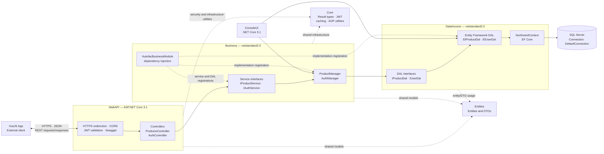
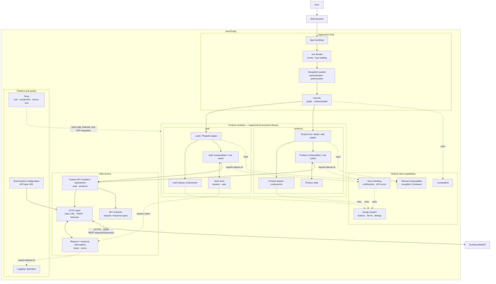
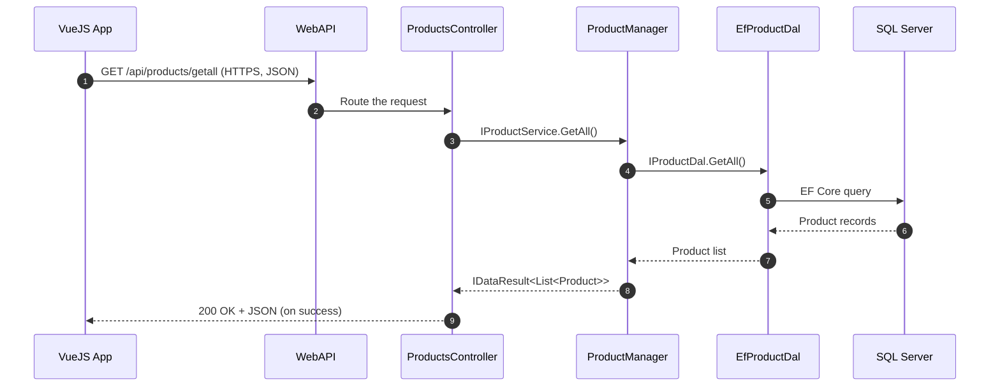

# Project Architecture

This repository is a layered application built with .NET Core  The diagrams below show the existing Web API and data layers, along with how the separately planned **VueJS App** would send requests to the API.
 

## Backend Component diagram

## VueJS App Scalable Frontend Architecture

## Example product request

## Available endpoints for the Vue.js client

| Method | Endpoint | Purpose |
| --- | --- | --- |
| `GET` | `/api/products/getall` | List products |
| `GET` | `/api/products/getbyid?id={id}` | Get a product by ID |
| `POST` | `/api/products/add` | Add a product |
| `POST` | `/api/products/update` | Update a product |
| `POST` | `/api/auth/login` | Sign in and obtain an access token |
| `POST` | `/api/auth/register` | Register and obtain an access token |

The Vue application should configure the API base URL using an environment variable, with the appropriate URL for each environment. After a successful login, the returned token can be sent in the request headers to endpoints protected by JWT.

## Current configuration notes

- `WebAPI/Startup.cs` configures Swagger, HTTPS redirection, CORS, and JWT validation. CORS currently allows all origins, methods, and headers; in production, it should be restricted to the Vue application's actual origin.
- Although JWT validation middleware is enabled, the current `ProductsController` actions do not have the `[Authorize]` attribute. Therefore, these actions are not currently restricted by JWT at the controller level.
- `NorthwindContext` reads the SQL Server connection string from `ConnectionStrings:DefaultConnection` in `appsettings.json`. Connection details are intentionally omitted from this diagram.
- `ConsoleUI` uses the Business and DataAccess layers directly instead of sending HTTP requests to the Web API, so it is shown separately from the Vue.js request flow.
